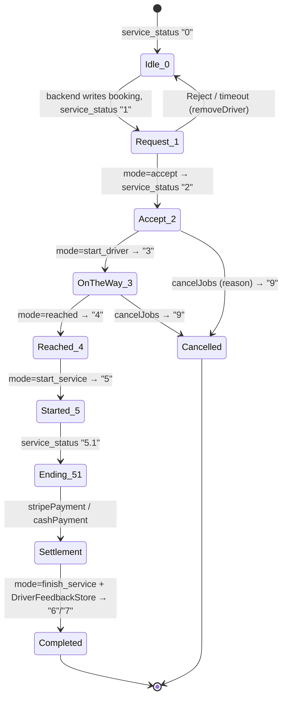

# PROVIDER_BOOKING_FLOW.md — InstaGuard Provider (Guard/Driver)

> **This is the most important document.** It answers precisely: *"When a User books a Guard from `instaguard-user`, exactly what happens inside `instaguard-provider` from the moment the booking is created until the booking is completed?"*
>
> Everything below is traced from the actual source code. Terminology note: in code the **Provider/Guard is called "Driver"** (`driverId`, Firebase node `providers/`); the **User/customer is "Customer"** (`customerId` / `struserIdFB`, Firebase node `users/`). The app is architecturally an **Uber-style on-demand + scheduled dispatch** app.

---

## 0. The single most important architectural fact

**New bookings do NOT arrive by FCM push or by polling a REST "get requests" endpoint.** They arrive through a **Firebase Realtime Database value listener** on the provider's own node:

```
providers/{driverId}/trips/service_status
```

- A background `Service` (`RequestServices`) and the foreground `MainActivity` both listen to this path.
- The **backend** (triggered by the user app creating a booking) writes the booking payload into `providers/{driverId}/trips/...` and sets `service_status = "1"`.
- The provider app reacts instantly: launches/opens `MainActivity`, reads the full booking payload from the same Firebase node, and shows the incoming-request UI.
- REST (Retrofit) is used only for **state transitions** (accept/start/reach/begin/end/cancel), lists (pending/upcoming/past), and profile/finance — **not** for receiving the request.

FCM (`MyFirebaseMessagingService`) is used only for generic tray notifications (`a_data` / `pn_city` payloads) and **Twilio voice call** invites — never for the live booking dispatch.

---

## 1. End-to-end sequence (actual implementation)

```text
instaguard-user APP
   │  user picks guard service, date/time, agents, location, payment
   ▼
BACKEND (https://backend.insta-guard.co.uk)
   │  creates booking row; decides dispatch:
   │  • On-demand (SOS / trip_type=1)  → pushes to a matched online provider
   │  • Scheduled (trip_type=2)        → creates a "pending"/"upcoming" job
   ▼
FIREBASE REALTIME DB
   │  writes providers/{driverId}/trips/{...booking fields...}
   │  sets providers/{driverId}/trips/service_status = "1"
   ▼
instaguard-provider APP
   │  RequestServices (background) sees service_status=="1" → startActivity(MainActivity)
   │  MainActivity value-listener on providers/{driverId}/trips fires callTripStatusFB()
   │  reads customer_id, customer_name, user_pickup, pickup_lat/lng, base_fare,
   │          total_agent, total_days, trip_type, start/end_date_time, special_ins,…
   │  shows lytRequestReceive + starts countDownTimerNormalReceivedRequest + plays tone
   ▼
PROVIDER DECISION
   ├── ACCEPT  → POST requestService? {mode:"accept", …}  (doAcceptRequestDetails)
   │              backend returns booking_id; backend advances service_status→"2"
   │              on-demand: shows lytJobInprogress
   │              scheduled (trip_type=2): routes to Your Jobs ▸ Upcoming
   ├── REJECT  → sets providers/{driverId}/trips/service_status="0" in Firebase
   │              + POST removeDriver {booking_id, driver_id}  (docallRemoveDriver)
   └── TIMEOUT (countdown hits 0) → same as reject (service_status="0" + clear)
   ▼
JOB IN PROGRESS — driven by providers/{driverId}/trips/service_status values
   "2" Accepttrip   → provider accepted, en route decision
   "3" ArriveTrips  → POST requestService? {mode:"start_driver"}  (doGetRequestStatusDetails)
   "4" ArriveTrip   → POST requestService? {mode:"reached"}
   "5" Starttrip    → POST requestService? {mode:"start_service"}  (service started)
   "5.1" Endtrip    → card/cash settlement UI
   ▼
COMPLETE
   │  POST requestService? {mode:"finish_service", …}  (doGetEndRequestStatusDetails)
   │  settlement: stripePayment (card)  / cashPayment (cash)
   │  provider rates the user: POST DriverFeedbackStore?
   │  backend sets service_status→"6"/"7"; booking moves to Past Jobs
   ▼
instaguard-user receives status updates (via its own Firebase users/{id}/trips listener)
```

---

## 2. Two booking modes (both exist in code)

| Mode | `trip_type` | How it reaches the provider | Where it shows |
|---|---|---|---|
| **On-demand / SOS** | `"1"` | Real-time Firebase `service_status="1"` → instant full-screen request with countdown | `MainActivity` request overlay (`lytRequestReceive`) |
| **Scheduled booking** | `"2"` | Same real-time push **or** appears as a list row | `MainActivity` request overlay; after accept routed to **Your Jobs ▸ Upcoming**. Pre-acceptance scheduled jobs are also listable via `pendingJobs` |

For `trip_type="2"`, the accept request additionally sends `booking_id`, `trip_type="2"`, `start_date_time`, `end_date_time` (see `callAcceptRequest`, MainActivity:3778-3783).

---

## 3. How the provider receives a new booking (detailed)

### 3.1 Background listener — `RequestServices`
File: `Helpers/Services/RequestServices.java` (registered `<service>` in manifest).

```java
requstStatus = FirebaseDatabase.getInstance().getReference()
    .child("providers").child(driverId)
    .child("trips")               // Utils.FIREBASE_TRIP_HEADER
    .child("service_status");     // Utils.FIREBASE_SERVICE_STATUS

// onDataChange:
if (status.matches("1") && !Utils.MAP_ISSHOWING) {
    Intent i = new Intent(this, MainActivity.class);
    i.addFlags(Intent.FLAG_ACTIVITY_NEW_TASK);
    startActivity(i);             // brings the request screen to front
}
```
Service returns `START_STICKY` so Android restarts it. This is what makes a booking "pop up" even when the app is backgrounded.

### 3.2 Foreground listener — `MainActivity.getTripStatusListener()` → `callTripStatusFB()`
File: `Activities/MainActivity.java:5940-6160+`. Attaches a `ValueEventListener` to `providers/{driverId}/trips` and switches on `service_status`:

| `service_status` | Internal `SP_MAP_TRIPSTATE` | UI shown |
|---|---|---|
| `"0"` | `Normalstate` | Online/idle (`lytOnlineOffline`) |
| `"1"` | `Request` | **Incoming request** (`lytRequestReceive`) + countdown + tone |
| `"2"` | `Accepttrip` | Job in progress (`lytJobInprogress`) |
| `"3"` | `ArriveTrips` | En route to customer |
| `"4"` | `ArriveTrip` | Reached customer |
| `"5"` | `Starttrip` | Service running |
| `"5.1"` | `Endtrip` | End/settlement UI + card payment |
| `"5.2"` | (additional charge) | Extra-charge settlement state |

### 3.3 Booking payload read from Firebase when `service_status="1"`
(`MainActivity:6018-6129`) — **these are the raw Firebase field names written by the backend into `providers/{driverId}/trips`:**

| Firebase key | Variable | Meaning |
|---|---|---|
| `customer_id` | `struserIdFB` | User id |
| `customer_name` | `struserNameFB` | User display name |
| `main_service` / `main_service_ar` | `strMainServiceFB` | Category name (EN/AR) |
| `sub_service` / `sub_service_ar` | `strSubServiceFB` | Service name (EN/AR) |
| `paymode` | `strPaymodeFB` | Payment mode label |
| `pickup_lat` / `pickup_lng` | `strPickupLatFB/LngFB` | Pickup coords |
| `user_pickup` | `strPickupLocationFB` | Pickup address text |
| `user_drop` | `strDropLocationFB` | Drop address (`"NoDrop"` if none) |
| `drop_lat` / `drop_lon` | `strDropLatFB/LngFB` | Drop coords |
| `distance` | `strdistanceFB` | Distance |
| `base_fare` | `strBasePriceFB` | Base price |
| `promocode` | `strPromoCodeFB` | Promo code |
| `special_ins` | `strSpecialInstFB` | Special instructions |
| `user_rating` | `struserRatingFB` | User's rating (shown on `ratingBarRequest`) |
| `trip_type` | `strTripTypeFB` | `"1"` SOS / `"2"` scheduled |
| `start_date_time` / `end_date_time` | `strStartDateTimeFB/EndDateTimeFB` | Scheduled window (reformatted `yyyy-MM-dd HH:mm`) |
| `total_agent` | `strCount` | Number of guards requested → `txtCount` |
| `total_days` | `strDays` | Number of days → `txtDays` |
| `customer_booking_id` | `strCustomerBookingIdFB` | User-side booking id (used by `removeDriver`) |
| `volunteer_status` | `strBackupVolunteerStatusFB` | `"1"` = SOS backup request |
| `transfer_status` | `strTransferJobStatusFB` | `"1"` = transferred job |

The user's live wallet + rating are additionally read from `users/{customer_id}` (`getCustomerWalletAmount`, MainActivity:4950): `wallet`, `rating`, and `trips/accept_status`.

### 3.4 Request countdown
(`MainActivity:1291-1352`) — `countDownTimerNormalReceivedRequest` runs for `SP_COMMON_REQUEST_TIME_DELAY_ACCEPT` seconds (from `appsetting.timedelay_accept`, fallback `Utils.countDownTimeLimit = 30`). On finish it **auto-rejects**: sets `service_status="0"` and calls `removeRequestDetailsFirebase()`.

---

## 4. ACCEPT booking

Trigger: `btnAcceptRequest` → cancels timer, `callAcceptRequest()` (`MainActivity:3720-3897`).

### API
```
POST requestService?
Retrofit:  doAcceptRequestDetails(token, accept, map)  → AcceptRequestModel
Headers:   Authorization: Bearer <accessToken>
           Accept: application/json
```
### Request body (normal on-demand, `volunteer_status=0`, `transfer_status=0`)
| Field | Value |
|---|---|
| `mode` | `"accept"` |
| `customer_id` | `struserIdFB` |
| `driver_id` | `driverId` |
| `customer_location` | `strPickupLocationFB` |
| `service_id` | `strSubCategoryid` |
| `category` | `strMainCategoryid` |
| `customer_lat` / `customer_lon` | pickup coords |
| `drop_lat` / `drop_lon` / `drop_location` | drop |
| `payment_type` | `strPaymentMode` (`wallet`/`card`) |
| `total_agent` / `total_days` | count / days |
| `stripe_token` + `card_number` | only when `payment_type=="card"` |
| `promocode` | `strPromoCodeFB` |
| `special_instruction` | `strSpecialInstFB` |
| `language` | short code |
| `customer_booking_id` | `strCustomerBookingIdFB` |
| `booking_id`, `trip_type="2"`, `start_date_time`, `end_date_time` | only when `trip_type=="2"` |

(Backup/transfer variants call `doAcceptBackupRequestDetails` → `VolunteerTrip` with `{mode:"accept", booking_id, from_driver_id, to_driver_id, transfer_status}`.)

### Response — `AcceptRequestModel`
`{ success, message, service_request: AcceptRequestDataModel }`. Success string: **`"Request saved successfully."`**
- `strBookingId = response.getAcceptRequestDataModel().getBookingId()` — the server booking id is now known.
- If `message == "something went wrong in accept."` → one silent retry (`aBooleanSomethingAcceptStatus`), else toast `try_again`.

### Post-accept UI
- `trip_type=="2"` (scheduled): hide request UI, route to **Your Jobs** with arg `main="upcoming"`.
- else (on-demand): show `lytJobInprogress`.
- Backend subsequently advances Firebase `service_status` to `"2"`, which the listener turns into the job-in-progress states.

### Accept semantics (answers to the required questions)
- **Payment required before acceptance?** No. For card jobs the stripe token was already captured on the user side and is relayed; settlement happens at completion.
- **Availability checked at accept?** Not in the app — the backend only dispatches to providers whose slots/online status already qualify (see Availability §9 of the master doc).
- **Can the provider accept multiple bookings?** The on-demand request UI is single-at-a-time (one `trips` node). Scheduled bookings can stack as Upcoming jobs.
- **Does acceptance reserve time?** For scheduled jobs, yes (moves to Upcoming). On-demand occupies the live trip state.
- **Confirmation popup?** No — Accept is a direct button; Reject/Cancel have dialogs.
- **Can acceptance fail?** Yes — `"something went wrong in accept."` (retry once) or HTTP 500 (`try_again` toast) / 401 (re-enable button).

---

## 5. REJECT booking

Trigger: `btnDeclineRequest` (`MainActivity:1640-1667`). **No reason dialog for on-demand reject** (reason is only collected for cancelling an in-progress job — §8).

Steps:
1. Cancel the countdown, stop the tone.
2. Firebase: `providers/{driverId}/trips/service_status = "0"`.
3. `removeRequestDetailsFirebase()` — resets `trips` node to `{service_status:"0"}` and clears `MY_PREFS_FB_CATEGORY_TRIPSTATE`.
4. Restore idle UI (`lytOnlineOffline`).
5. If `transfer_status=="0"` && `volunteer_status=="0"` → `callRemoveDriver()`.

### `callRemoveDriver()` (`MainActivity:9904`)
```
POST removeDriver      (docallRemoveDriver)  → BankModel
Body: { booking_id: strCustomerBookingIdFB, driver_id: driverId }
```
Success string: `"success"`. This tells the backend to remove this provider from the booking's candidate list so the user app can offer it to the next guard. (`callNotifySend(... mode:"reject")` via `notifysend?` exists but is commented out at the reject site.)

> **Rejection reason is NOT required/sent** for the real-time reject. It is effectively a silent decline + timeout equivalent.

---

## 6. In-progress status transitions (START SERVICE path)

All use the shared `requestService?` endpoint with a different `mode`, via `callRequestServicesStatus(status)` (`MainActivity:3926-4034`) → `doGetRequestStatusDetails`. Headers: `Authorization: Bearer <token>`, `Accept: application/json`. Success string for all: **`"Request saved successfully."`**

| Button / action | `status` arg | `mode` sent | Body | Resulting button shown |
|---|---|---|---|---|
| Start trip (on the way) | `"3"` | `start_driver` | `driver_id, booking_id, language` | `btnArrivetrip` |
| Arrive / reached | `"4"` | `reached` | same | `btnBeginjobtrip` |
| Begin job / start service | `"5"` | `start_service` | same | `btnEndjobtrip` |

(Transfer/backup jobs use `doGetBackupRequestStatusDetails` → `VolunteerTrip` with `from_driver_id/to_driver_id/transfer_status`.)

Each successful call reads `strBookingId = response.getRequestStatusData().getBookingId()`. The backend mirrors the new state into Firebase `service_status` (`3`/`4`/`5`), which re-drives the UI via `callTripStatusFB`.

---

## 7. COMPLETE booking / END SERVICE

Trigger: `btnEndjobtrip` → `callEndtrip(key)` (`MainActivity:4037-4167`). `key` = payment type (`cash` / `both` / card).

### API
```
POST requestService?   (doGetEndRequestStatusDetails)  → EndRequestModel
Headers: Authorization: Bearer <token>, Accept: application/json
```
### Body
| Field | Value |
|---|---|
| `mode` | `"finish_service"` |
| `driver_id` | `driverId` |
| `booking_id` | `strBookingId` |
| `customer_id` | `struserIdFB` |
| `material_fee` | `edtMaterialFee` (0.0 default) |
| `misc_charge` | `edtMiscFee` |
| `driver_discount` | `edtDiscountDriver` |
| `distance` / `drop_location` | `"0"`/`"NoDrop"` or real values |
| `drop_lat` / `drop_lon` | current location |
| `payment_type` | `key` |
| `wallet_amount`, `total_amount`, `customer_id` | when `key=="both"` |
| `promocode` | if present |
| `total_agent`, `total_days`, `language` | always |

Success: `"Request saved successfully."` → hides end-charge dialog, proceeds to settlement + trip summary.

### Settlement
- **Card / wallet:** `callStripeUpdate()` → `POST stripePayment` (`doStripUpdateEndTrip`) with `{booking_id, amount, driver_id, customer_id, mode:"0", material_fee, misc_charge, driver_discount, distance, type, language}`. Success: `"Money debited successfully."` / `"success"`.
- **Cash:** `updateCashonHandPayment()` → `POST cashPayment` (`doUpdatePaymentDetails`) with `{booking_id, driver_id, customer_id}`; on success sets Firebase `booking_trips/{id}/cash_status=1` and `providers/{driverId}/trips/cash_status=1`.

### Earnings impact
Settlement credits the provider's server-side earnings (`earn_cash`/`earn_card`) and wallet; the per-job amount shows later under **Wallet Transactions** (`TransactionDriver`) and **Bonus** (`BonusTransactionList`). Earnings totals are read from `profileViewDriver` (`wallet`, `earnings`, `earn_cash`, `earn_card`, `driver_paid`, `admin_paid`).

### Review flow
After completion the trip-summary card shows a rating bar; provider rates the user via `callUpdateRating()`:
```
POST DriverFeedbackStore?   (doUpdateRatingUser)  → RatingUserModel
Body: { from_id: driverId, to_id: struserIdFB, job_id: strBookingId, rating, status:"0", feedback }
```
Success: `"Feedback received"` → sets Firebase `providers/{driverId}/trips/rating_status="1"`. Collecting payment resets `service_status="0"` (back to idle) and the booking becomes a **Past Job** (`service_status` 6/7).

---

## 8. CANCEL an accepted / in-progress job

Trigger: `btnCancelJobsInProgress` → cancel dialog (`dialogCancelJobinfos`) collecting a **reason + comment** → `callCancelJobUserUpdate(reason, comment)` (`MainActivity:4432`).

### API (normal job)
```
POST cancelJobs?   (doCancelJobDetails)  → CancelJobModel
Headers: Authorization: Bearer <token>, Accept: application/json
Body: { booking_id, driver_id, reason: "<reason>-<comment>", mode:"driver", language }
```
Success: `"Cancelled successfully."` → dismiss dialog, set Firebase `users/{customer_id}/trips/accept_status="0"` (frees the user). Transfer/backup jobs use `doCancelBackupJobDetails` → `VolunteerTrip` with `{mode:"cancel", booking_id, from_driver_id, to_driver_id, transfer_status}`.

> For **scheduled Upcoming jobs** cancellation uses a different endpoint — `scheduledcancelJobs?` (`doDeclinePendingJobs`) with `{booking_id, driver_id, mode:"driver"}`, success `"Cancelled successfully."` (see `PROVIDER_APP_DOCUMENTATION.md` §12).

---

## 9. Booking status lifecycle (authoritative)

Two parallel status spaces exist. **Firebase `service_status`** drives the live on-demand trip UI; the **REST `service_status` integer** on job-list rows describes scheduled bookings.

### 9.1 Firebase live `providers/{driverId}/trips/service_status`
| Value | State | Set by |
|---|---|---|
| `0` | Idle / no active request (`Normalstate`) | provider (reject/timeout/complete) or backend |
| `1` | New request received (`Request`) | **backend** when user books |
| `2` | Accepted (`Accepttrip`) | backend after `mode:accept` |
| `3` | Driver on the way (`ArriveTrips`) | backend after `mode:start_driver` |
| `4` | Driver reached (`ArriveTrip`) | backend after `mode:reached` |
| `5` | Service started (`Starttrip`) | backend after `mode:start_service` |
| `5.1` | Ending / settlement (`Endtrip`) | backend |
| `5.2` | Additional-charge settlement | backend |

### 9.2 User node `users/{customer_id}/trips/accept_status`
| Value | Meaning |
|---|---|
| `1` | Customer requesting |
| `2` | Customer cancelled the request |
| `3` | Customer request timed out |

### 9.3 REST job-list `service_status` integers (scheduled jobs)
| Value | Meaning (string resource) |
|---|---|
| `6` | Completed, awaiting customer confirmation |
| `7` | Job finished successfully |
| `8` | Cancelled by customer |
| `9` | Cancelled by driver |
| `13` | Upcoming job accepted by driver (actionable) |
| `14` | Scheduled cancel by user |
| `15` | Scheduled cancel by driver |

> Only these values were found in code. There is no separate string-enum like "pending"/"completed" — statuses are integers plus Firebase dispatch codes.

---

## 10. Mermaid — complete User → Provider sequence (actual APIs)

```mermaid
sequenceDiagram
    participant U as instaguard-user
    participant API as Backend (api/v3)
    participant FB as Firebase RTDB
    participant P as instaguard-provider

    U->>API: create booking (service, date, agents, location, payment)
    API->>FB: write providers/{driverId}/trips/{...}
    API->>FB: set providers/{driverId}/trips/service_status = "1"
    FB-->>P: RequestServices listener → launch MainActivity
    FB-->>P: callTripStatusFB() reads customer_id, user_pickup, base_fare, total_agent...
    P->>P: show request UI + countdown (timedelay_accept) + tone

    alt Provider ACCEPTS
        P->>API: POST requestService? {mode:"accept", customer_id, driver_id, ...}
        API-->>P: {message:"Request saved successfully.", service_request:{booking_id}}
        API->>FB: service_status = "2"
        FB-->>P: job in progress
    else Provider REJECTS or TIMEOUT
        P->>FB: service_status = "0"; removeRequestDetailsFirebase()
        P->>API: POST removeDriver {booking_id, driver_id}
        API->>FB: notify user app to try next guard
    end

    P->>API: POST requestService? {mode:"start_driver"}  (on the way)
    API->>FB: service_status = "3"
    P->>API: POST requestService? {mode:"reached"}
    API->>FB: service_status = "4"
    P->>API: POST requestService? {mode:"start_service"}
    API->>FB: service_status = "5"
    P->>API: POST requestService? {mode:"finish_service", material_fee, misc_charge,...}
    API-->>P: "Request saved successfully."
    P->>API: POST stripePayment / cashPayment (settlement)
    P->>API: POST DriverFeedbackStore? {from_id:driver, to_id:user, job_id, rating}
    API->>FB: service_status = "6"/"7"  (→ Past Jobs)
    FB-->>U: user sees completed booking
```

---

## 11. Mermaid — booking state machine (live trip)



---

## 12. Firebase node map (what the provider reads/writes)

```
providers/{driverId}/
    status                 "1" online / "0" offline          (checkin)
    wallet                 cached wallet balance
    approved               "1" documents approved
    pending                scheduled pending count (listener)
    upcoming               upcoming count (listener)
    transfer_request       "0"/"1"/"2" transfer flow
    subs_buy_status        "1" success / "2" fail (subscription)
    return_status          stripe onboarding return
    distance / est_distance / est_duration
    trips/
        service_status     ← PRIMARY DISPATCH SIGNAL (0,1,2,3,4,5,5.1,5.2)
        accept_status
        booking_id, customer_id, customer_name, main_service, sub_service,
        paymode, pickup_lat, pickup_lng, user_pickup, user_drop, drop_lat, drop_lon,
        distance, base_fare, promocode, special_ins, user_rating,
        trip_type, start_date_time, end_date_time, total_agent, total_days,
        customer_booking_id, volunteer_status, transfer_status, card_status,
        cash_status, rating_status

users/{customer_id}/
    wallet, rating
    trips/accept_status     (1 requesting, 2 cancelled, 3 timeout)

drivers_location/{driverId}/   (GeoFire: lat/lng + status)   ← online dispatch matching
booking_trips/{bookingId}/     (cash_status, service_status mirror)
Notifications/Offers|Announcements/provider   (offers/announcements feed)
```

---

## 13. Minimum set of endpoints to rebuild the booking flow in Flutter

| Purpose | Method + Path | Retrofit method |
|---|---|---|
| Receive request | *(Firebase RTDB listener on `providers/{driverId}/trips/service_status`)* | — |
| Accept | `POST requestService?` `{mode:"accept",...}` | `doAcceptRequestDetails` |
| On the way | `POST requestService?` `{mode:"start_driver"}` | `doGetRequestStatusDetails` |
| Reached | `POST requestService?` `{mode:"reached"}` | `doGetRequestStatusDetails` |
| Start service | `POST requestService?` `{mode:"start_service"}` | `doGetRequestStatusDetails` |
| Complete | `POST requestService?` `{mode:"finish_service",...}` | `doGetEndRequestStatusDetails` |
| Remove on reject | `POST removeDriver` | `docallRemoveDriver` |
| Card settle | `POST stripePayment` | `doStripUpdateEndTrip` |
| Cash settle | `POST cashPayment` | `doUpdatePaymentDetails` |
| Rate user | `POST DriverFeedbackStore?` | `doUpdateRatingUser` |
| Cancel job | `POST cancelJobs?` | `doCancelJobDetails` |
| Pending list | `POST pendingJobs?` | `doCustomerPendingJobs` |
| Accept pending | `POST scheduleJobAccept?` | `doAcceptPendingJobs` |
| Decline pending | `POST scheduledcancelJobs?` | `doDeclinePendingJobs` |
| Upcoming list | `POST upcomingJobs?` | `doCustomerUpcomingJobs` |
| Start upcoming | `POST scheduletripStart?` | `doStartUpcomingJobs` |
| Past list | `POST pastjobs?` | `doCustomerPastJobs` |
| Online/offline + location | `POST checkin?` | `doDriverUpdateLocation` |

> Full request/response field tables for every endpoint are in `PROVIDER_API_DOCUMENTATION.md`.
